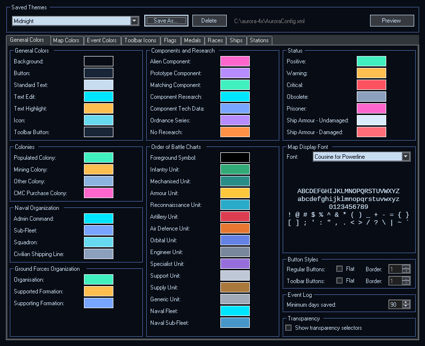
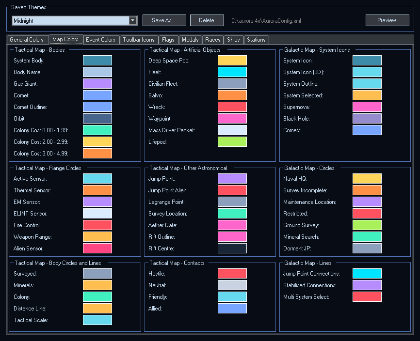
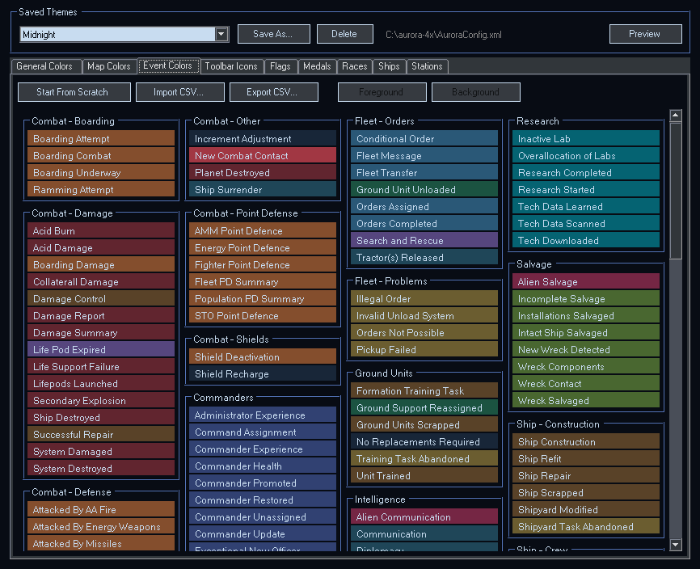
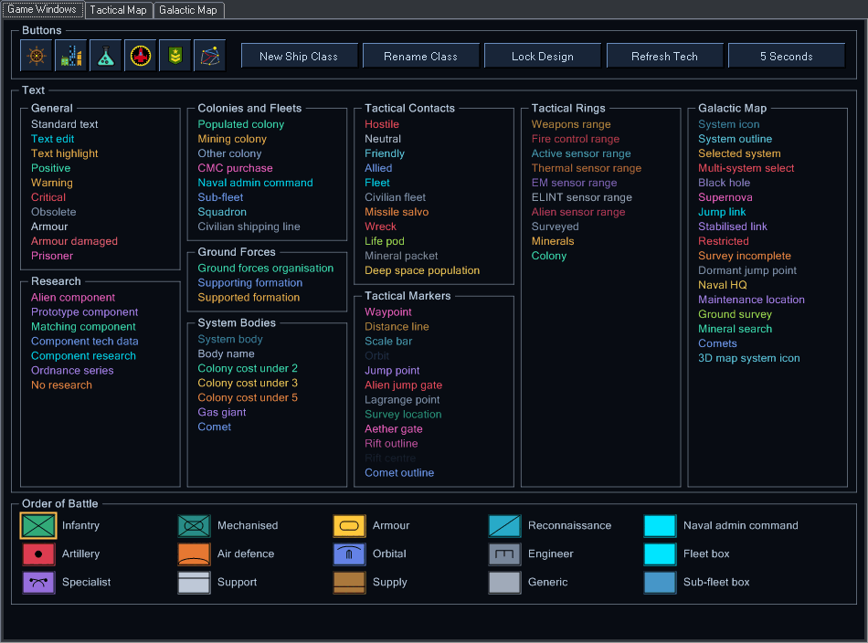
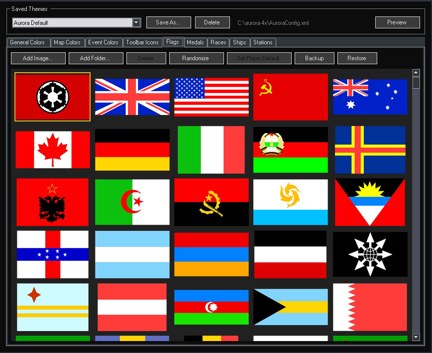
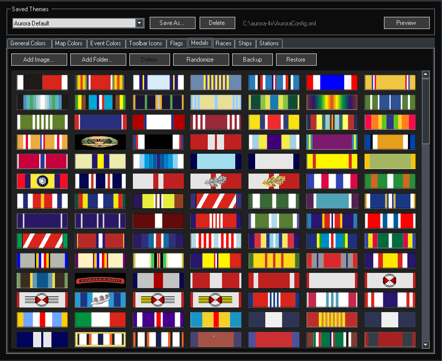
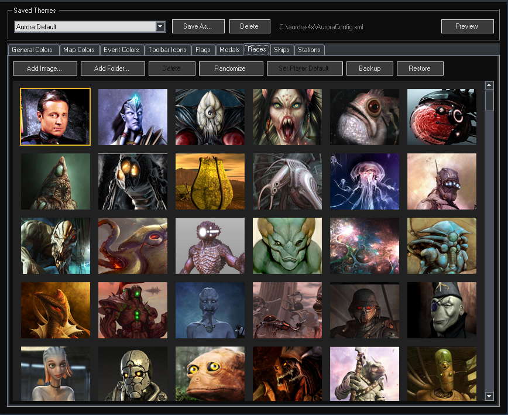
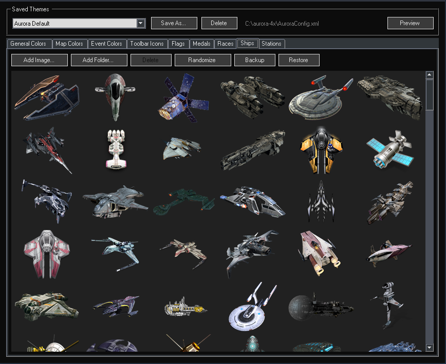
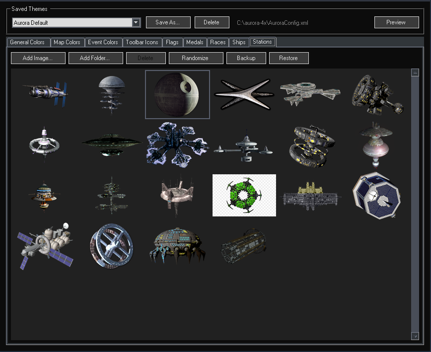

# Aurora Theme Manager (ATM)

A theme editor for [Aurora 4X](https://aurora4x.com/).

Aurora Theme Manager provides:

- A clickable UI for modifying every color defined in the AuroraConfig.xml file
- A preview window allows you to see changes to the theme colors in real-time
- The ability to save, restore, and delete any number of themes created manually or obtained from the forums or other sources.
- The ability to change toolbar icons from any of the 4,000+ icons from [game-icons.net](https://game-icons.net), or use your own .svg images
- The ability to generate a .csv file to configure event colors.  The .csv can be imported by the player in-game.
- Flag, medal, race, ship and station image management.



## Getting started

1. Copy `ATM.exe` into your Aurora folder.
2. Run `ATM.exe`. If there is no `AuroraConfig.xml` yet, one is created with Aurora's default colors.
3. Every change to colors, button styles, and fonts are written to `AuroraConfig.xml` straight away, and the file as it was before the first change of a session is kept as `AuroraConfig.xml.bak`.

Running `ATM.exe` will create a folder called `ATM` to store settings, saved themes, backups and a cache of downloaded icons and image thumbnails (`ATM\Cache`, with a folder for each kind), so your Aurora install is not cluttered.  A new `ATM.exe` can simply replace the old one: any folders an earlier version left are moved into place when it starts.

The first time it runs, ATM copies Aurora's `Flags`, `Medals`, `Races`, `ShipIcons` and `StationIcons` folders into `ATM\Backups`, so the images as they existed can always be restored.  Each folder is copied once, when `ATM\Backups` does not hold it yet.  It also zips the five folders as they are when ATM first runs, into `ATM\Backups\Originals.zip`; once that file exists it is never changed, so the original images can always be recovered from it.

## Editing colors

The **General Colors** and **Map Colors** tabs hold every color in `AuroraConfig.xml`, grouped by the part of the game that uses it.

- Click a swatch to open the color picker.
- Turn on **Show transparency selectors** to set an alpha value (0 to 255) beside each color (except for the main backgound color).
  - Aurora throws an error if the main background color is given an alpha value
- **Button styles** (flat/standard, and border width) and **map font** can be modified.
- The **minimum days of event logs** saved to the database can be changed here as well.



## Event colors

Aurora stores event colors in each saved game, not `AuroraConfig.xml`, so the **Event Colors** tab edits a set of colors and exports it as a CSV for the player to import into Aurora's **Events** window.

- Events are grouped by category, each drawn in its own colors.
- Click to select an event, Ctrl+Click to multi-select, and Shift+Click to select a range of items.
- **Foreground** and **Background** change the colors of the selected event(s).
- Right-click an event to copy, paste or reset colors; right-click a category to select all items in that category.
- **Import CSV** loads an already-existing events CSV file.
- **Start From Scratch** resets every event to the theme's colors.
- **Export CSV** saves the current event colors.



## Live preview

**Preview** opens a second window that draws your current colors the way Aurora uses them. Hover anything to see which color it is, and click it to change that color.

**Game Windows** shows the toolbar and buttons, every text color written in its own color on the window background, and the Order of Battle unit boxes.



**Tactical Map** draws a sample system with bodies, orbits, fleets, contacts, sensor and weapon range rings, jump points and the other map markers.


**Galactic Map** draws a small network of systems with their survey, naval HQ, maintenance and restricted markers, and jump point connections.


## Themes

A theme is a full set of colors, button styles and the map font. Pick one from **Saved Themes** at the top of the window to apply it.

- **Save As** stores the current settings as a new theme, and **Save** updates the selected one.
- **Reset** throws away unsaved changes, and **Delete** removes a theme.
- Themes are saved in `ATM\Presets` as `.xml` files in exactly the same format as `AuroraConfig.xml`.
- On first run, if `AuroraConfig.xml` already holds settings other than Aurora's defaults, it is saved as a theme named `Backup - ` and the time it was copied (for example `Backup - 2026-11-10_03-13-40`), so your existing colors are never lost.
- If you switch themes with unsaved changes, including changes made to `AuroraConfig.xml` outside ATM, you are asked whether to save them first.

## Toolbar icons

The **Toolbar Icons** tab replaces the SVG toolbar icons in Aurora's `Icons` folder.

- The list on the left is Aurora's current icons. The grid on the right holds the game-icons.net catalogue, which you can filter by name. Hover an icon to see its name and author.
- Pick an Aurora icon and a replacement, then click **Update**. **Select Custom Icon** uses an `.svg` file of your own instead.
- The originals are backed up in `ATM\Backups\Icons` the first time you replace them. **Restore original** and **Restore all** put them back.  Backups made by earlier versions of ATM in `ATM\IconBackups` are moved there automatically.


## Flags, Medals, Races, Ships and Stations

These five tabs work the same way: each shows thumbnails of one of Aurora's image folders (`Flags`, `Medals`, `Races`, `ShipIcons`, `StationIcons`).

- **Add Image** and **Add Folder** adds images to the relevant folder.  Files are converted to match the default type Aurora expects for each type (`.bmp` races, `.jpg` flags, `.png` ships and stations).
- **Randomize** shuffles the images in the folder.  Aurora uses specific files for the spoiler races, so they always look the same between games.  This allows the spoiler races to have different images.
- **Set Player Default** (Races and Flags) picks the image a new game gives the player: ATM swaps the selected file's name with the default (`race327.bmp`, `flag0000.jpg`).  The default is outlined in gold.  The Randomize button doesn't change the player default images.
- **Backup** and **Restore** Copies the current set of images to/from (`ATM\Backups\<folder>`).


### Placeholder images
Aurora throws an error when an image it expects is missing.  ATM checks `AuroraDB.db` (read-only) to learn which file names are specified, and ensures those files are retained.  The player defaults and the spoiler races' images in place:

- Randomize never removes a name in use.
- Deleting one renames a spare image into its place.  If there is no spare image available, ATM creates a placeholder image using the current theme's colors and swaps it.
- When new images are imported into the folder, the placeholder images are replaced first.
- The same check runs when ATM starts and when files are changed outside it.  Fixes are noted in `ATM.log`.







## Building

ATM is an SDK-style `net48` project that builds on Windows and Linux with the .NET SDK 6.0 or later. The .NET Framework reference assemblies come from NuGet, so no targeting pack or Mono install is needed.

```sh
dotnet build AuroraThemeManager.csproj -c Release
```

Visual Studio 2019 or later opens `AuroraThemeManager.sln`.

## Notes

- Icons are drawn with the `Svg.dll` that ships with Aurora, loaded from the Aurora folder.
- `Standard Symbols PS` is left out of the map font list, because Wine crashes drawing one of its characters.
- Transparency does not suit every color in Aurora. An alpha value is only written for colors that already have one or are set below 255.

## License

- Aurora Theme Manager is released under the [MIT License](LICENSE).

- Aurora Theme MAnager was developed with the help of Claude (Anthropic) via Claude Code.


## Credits

- Aurora 4X is written by Steve Walmsley.

- Replacement icons come from [game-icons.net](https://game-icons.net), licensed under
[CC BY 3.0](https://creativecommons.org/licenses/by/3.0/).
