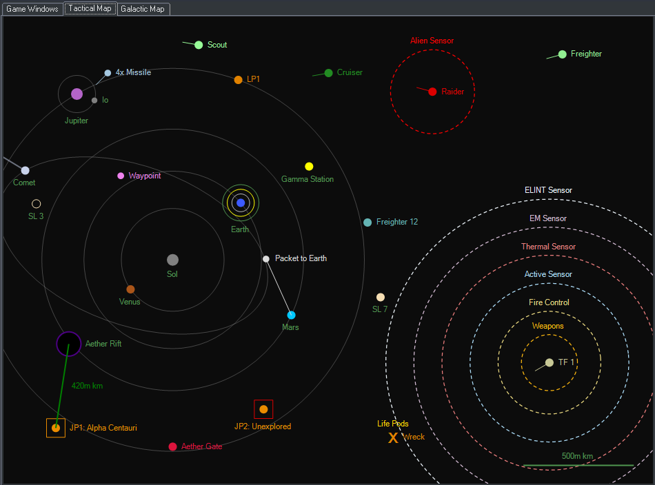
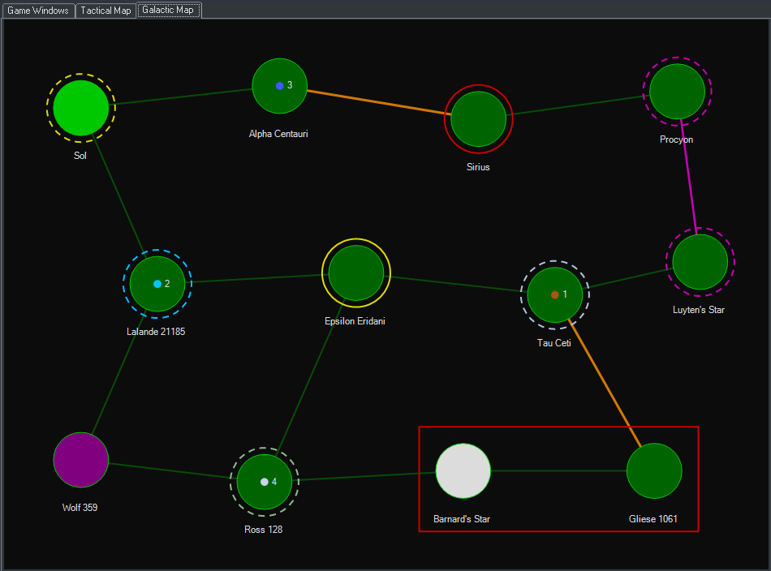
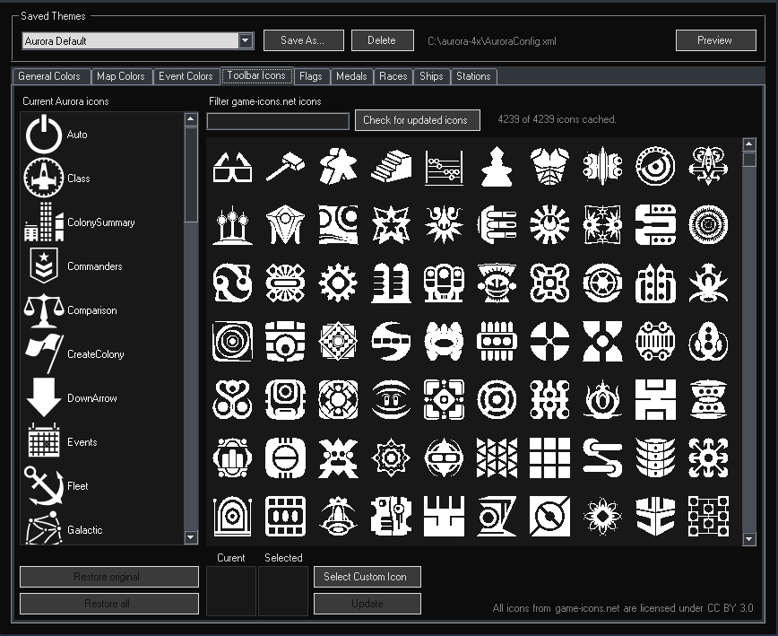

# Aurora Theme Manager (ATM)

A theme editor for [Aurora 4X](https://aurora4x.com/).

Aurora keeps its colors, button styles, map font and event log settings in `AuroraConfig.xml`, and its
toolbar icons as SVG files in the `Icons` folder. Aurora Theme Manager edits both for you:

- every color Aurora exposes, grouped by where the game uses it
- a live preview of game windows, the tactical map and the galactic map
- themes you can save, switch between and share
- toolbar icons replaced with any of the 4,000+ icons from [game-icons.net](https://game-icons.net)
- flag, medal, race, ship and station images added in bulk, and shuffled so new races get different ones


## Getting started

1. Copy `ATM.exe` into your Aurora folder.
2. Run `ATM.exe`. If there is no `AuroraConfig.xml` yet, one is created with Aurora's default colors.
3. Change colors. Every change is written to `AuroraConfig.xml` straight away, and the file as it was
   before the first change of a session is kept as `AuroraConfig.xml.bak`.

Running `ATM.exe` will create a folder called `ATM` to store settings, saved
themes, backups and a cache of downloaded icons and image thumbnails (`ATM\Cache`, with a folder for
each kind), so your Aurora install is not cluttered.  A new `ATM.exe` can simply replace the old one: any
folders an earlier version left are moved into place when it starts.

The first time it runs, ATM copies Aurora's `Flags`, `Medals`, `Races`, `ShipIcons` and `StationIcons`
folders into `ATM\Backups`, so the images as they were can always be put back by hand.  Each folder is
copied once, when `ATM\Backups` does not hold it yet.  It also zips the five folders, as they are when ATM
first runs, into `ATM\Backups\Originals.zip`; once that file exists it is never changed, so the original
images can always be recovered from it.

## Editing colors

The **General Colors** and **Map Colors** tabs hold every color in `AuroraConfig.xml`, grouped by the part of the
game that uses it.

- Click a swatch to open the color picker.
- Turn on **Show transparency selectors** to set an alpha value (0 to 255) beside each color (except for the main backgound color).
  - Aurora throws an error if the main background color is given an alpha value, so it is
- **Button styles** (flat/standard, and border width) and **map font** can be modified.
- The **minimum days of event logs** saved to the database can be changed here as well.


## Live preview

**Preview** opens a second window that draws your current colors the way Aurora uses them. Hover
anything to see which color it is, and click it to change that color.

**Game Windows** shows the toolbar and buttons, every text color written in its own color on the window
background, and the Order of Battle unit boxes.


**Tactical Map** draws a sample system with bodies, orbits, fleets, contacts, sensor and weapon range
rings, jump points and the other map markers.



**Galactic Map** draws a small network of systems with their survey, naval HQ, maintenance and
restricted markers, and jump point connections.



## Themes

A theme is a full set of colors, button styles and the map font. Pick one from **Saved Themes** at the top
of the window to apply it.

- **Aurora Default** (the colors Aurora ships with) and **ATM Alternate** (a dark blue-grey theme) are
  built into `ATM.exe`.
- **Save As** stores the current settings as a new theme, and **Save** updates the selected one.
  **Reset** throws away unsaved changes, and **Delete** removes a theme.
- Themes are saved in `ATM\Presets` as `.xml` files in exactly the same format as `AuroraConfig.xml`.
  A theme file can be shared as is, or copied into an Aurora folder and renamed `AuroraConfig.xml` to use
  it without ATM. Any `AuroraConfig.xml` copied into `ATM\Presets` (renamed to the theme's name) shows up
  as a theme, the next time you open the list.
- Applying a theme only changes its colors, button styles and map font; other settings in
  `AuroraConfig.xml`, such as the event log, are left as they are.
- On first run, if `AuroraConfig.xml` already holds settings other than Aurora's defaults, it is saved as a
  theme named `Backup - ` and the time it was copied (for example `Backup - 2026-11-10_03-13-40`), so your
  existing colors are never lost.
- If you switch themes with unsaved changes, including changes made to `AuroraConfig.xml` outside ATM,
  you are asked whether to save them first.

## Toolbar icons

The **Toolbar Icons** tab replaces the SVG toolbar icons in Aurora's `Icons` folder.

- The list on the left is Aurora's current icons. The grid on the right holds the game-icons.net
  catalogue, which you can filter by name. Hover an icon to see its name and author.
- Pick an Aurora icon and a replacement, then click **Update**. **Select Custom Icon** uses an `.svg` file of
  your own instead.
- The originals are backed up in `ATM\Backups\Icons` the first time you replace them. **Restore original**
  and **Restore all** put them back.  Backups made by earlier versions of ATM in `ATM\IconBackups` are
  moved there automatically.



## Images

The **Flags**, **Medals**, **Races**, **Ships** and **Stations** tabs show thumbnails of the images in
Aurora's `Flags`, `Medals`, `Races`, `ShipIcons` and `StationIcons` folders.

- **Add Image** copies one image into the folder, and **Add Folder** copies every image in a folder.
  Both start in `ATM\Extra Graphics\<folder>` (for example `ATM\Extra Graphics\Races`), so images of
  your own can be dropped there and added from one place.  ATM creates these folders if they are missing.
- Each image added is named like the images already in the folder, with the lowest number not yet
  used by any file of any type: with `race001.bmp` and `race003.bmp` in `Races`, a new image becomes
  `race002.bmp`.
- Images are saved in the same type as the images Aurora ships in that folder: `.bmp` for races, `.jpg`
  for flags and `.png` for ships and stations, so new images are treated just like the originals.
  Transparent parts of an image converted to `.bmp` or `.jpg` become black.  Medals keep their own type.
- **Delete** (or the Delete key) deletes the selected images.  Some file names are in use and must not go
  missing: the player defaults, the images of the spoiler races, and every image a race, species or medal
  in one of your saved games uses (read from `AuroraDB.db`).  When one of those is deleted, a random unused
  image of the same type is renamed to take its name, so the game does not show an error.  If no unused image
  is left, a placeholder image in the theme's colors is created.
- **Missing images**: when ATM starts, and whenever images are deleted or renamed outside ATM while it is
  open, every name referenced by a saved game is checked, and any that are missing are replaced the
  same way (noted in `ATM.log`).  This needs `AuroraDB.db` to be readable; if it can't be read, the
  check is skipped.
- **Placeholders**: Placeholder images are automatically created in the current theme's background color, text
  edit color and map font.  ATM remembers its placeholders (in `ATM\Placeholders.txt`) and replaces them with real
  images when there are enough when clicking **Randomize**, **Add Image**, or  **Add Folder**.
- **Backup** copies the folder as it is now to `ATM\Backups\<folder>`, asking first if that would overwrite an existing backup.
- **Restore** replaces the folder's images with those from the backup directory.
- **Randomize** shuffles the images in the folder, so the spoiler races can get new images to keep you guessing.
  Before shuffling, every image that is not of the folder's type (`.bmp` for races, `.jpg` for flags, `.png` for ships,
  stations and medals) is converted, unless its name is in use.  In that case the name is kept exactly,
  and whichever image is shuffled into its place is converted to that type instead, so no image Aurora looks for
  goes missing.  Randomize needs to read `AuroraDB.db` for this, and does nothing if it cannot.
- **Set Player Default** (Races and Flags) makes the selected image the default image for a player race when starting a new game.
  New games use `race327.bmp` for the player's species and `flag0000.jpg` for the
  player's flag, so the selected image's file name is swapped with that name: the old default takes the
  selected image's name, and no file name is lost.  The default is shown first, outlined in gold, and **Randomize** never moves
  it.

## Building

ATM is an SDK-style `net48` project that builds on Windows and Linux with the .NET SDK 6.0 or later. The
.NET Framework reference assemblies come from NuGet, so no targeting pack or Mono install is needed.

```sh
dotnet build AuroraThemeManager.csproj -c Release
```

Visual Studio 2019 or later opens `AuroraThemeManager.sln`.

## Notes

- Icons are drawn with the `Svg.dll` that ships with Aurora, loaded from the Aurora folder.
- `Standard Symbols PS` is left out of the map font list, because Wine crashes drawing one of its
  characters.
- Transparency does not suit every color in Aurora. An alpha value is only written for colors that
  already have one or are set below 255.

## License

Aurora Theme Manager is released under the [MIT License](LICENSE).

## Credits

- Aurora 4X is written by Steve Walmsley.

- Replacement icons come from [game-icons.net](https://game-icons.net), licensed under
[CC BY 3.0](https://creativecommons.org/licenses/by/3.0/).

- Aurora Theme Manager was developed with the help of Claude (Anthropic) via Claude Code.
